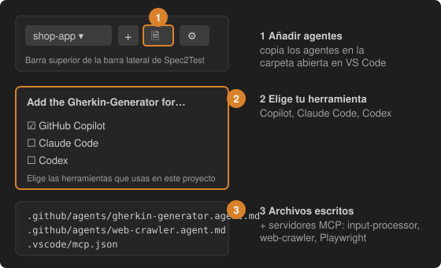

# 4 · Añade los agentes Gherkin-Generator y web-crawler

Abre en VS Code la carpeta donde viven las pruebas de tu proyecto, comprueba que el proyecto correcto está seleccionado en la barra lateral y pulsa el **botón del documento con un check** de la barra superior (*Add the Gherkin-Generator agent to this workspace*), o ejecuta el comando de este paso.

Elige las herramientas que usas:

| Herramienta | Archivos escritos |
| --- | --- |
| GitHub Copilot | `.github/agents/gherkin-generator.agent.md`, `.github/agents/web-crawler.agent.md`, servidores en `.vscode/mcp.json` |
| Claude Code | `.claude/skills/gherkin-generator/`, `.claude/agents/web-crawler.md`, servidores en `.mcp.json` |
| Codex | `.agents/skills/gherkin-generator/`, un bloque marcado en `.codex/config.toml` |

La configuración MCP apunta al **input-processor** (con tu proyecto seleccionado en la cabecera `X-Spec2Test-Project`), al **web-crawler** y a **Playwright** (requiere Node.js). La configuración existente se fusiona, nunca se reemplaza. Al cambiar de proyecto en la barra lateral se actualiza la cabecera; **⋮ → Use this project for agents** lo hace de forma explícita.

Después pídeselo al agente en el chat, por ejemplo: *"Usa el gherkin-generator para crear las features de este proyecto"*.
