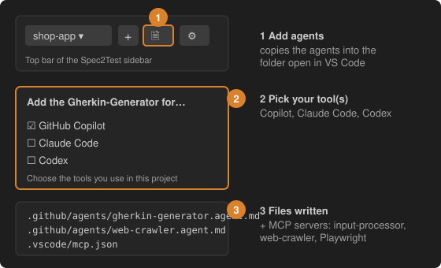

# 4 · Add the Gherkin-Generator and web-crawler agents

Open the folder where your project's tests live in VS Code, make sure the right project is selected in the sidebar, then press the **document-with-a-check button** in the top bar (*Add the Gherkin-Generator agent to this workspace*), or run the command from this step.

Pick the tools you use:

| Tool | Files written |
| --- | --- |
| GitHub Copilot | `.github/agents/gherkin-generator.agent.md`, `.github/agents/web-crawler.agent.md`, servers in `.vscode/mcp.json` |
| Claude Code | `.claude/skills/gherkin-generator/`, `.claude/agents/web-crawler.md`, servers in `.mcp.json` |
| Codex | `.agents/skills/gherkin-generator/`, a marked block in `.codex/config.toml` |

The MCP settings point at the **input-processor** (with your selected project in the `X-Spec2Test-Project` header), the **web-crawler** and **Playwright** (needs Node.js). Existing configuration is merged, never replaced. Switching project in the sidebar updates the header; **⋮ → Use this project for agents** does it explicitly.

Then ask the agent in chat, for example: *"Use the gherkin-generator to create the features for this project"*.
