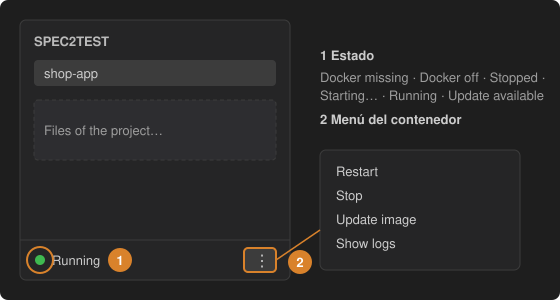

# 1 · Configura la extensión e inicia Docker

Spec2Test ejecuta dos contenedores: el **input-processor** (lee tus especificaciones y grabaciones) y un **web crawler** (explora tu aplicación para el agente de Gherkin). Instala Docker Desktop (macOS, Windows) o Docker Engine (Linux) y ponlo en marcha.

1. **Estado**: el pie de la barra lateral de Spec2Test te dice qué falta: *Docker missing*, *Docker off*, *Stopped*, *Starting…*, *Running*, *Update available* o *Not responding*. El botón junto al estado ofrece siempre el siguiente paso (*Get Docker*, *Start Docker*, *Start input-processor*, *Update image and restart*).
2. **Menú del contenedor (⋮)**: *Start*, *Stop*, *Restart*, *Update image* y *Show logs*. El primer arranque descarga las imágenes y puede tardar unos minutos.

Espera a ver **Running** antes de continuar. Para arrancar los contenedores automáticamente, activa el ajuste `spec2test.autoStartService`.
