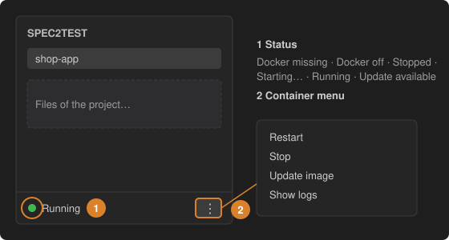

# 1 · Set up the extension and start Docker

Spec2Test runs two containers: the **input-processor** (reads your specs and recordings) and a **web crawler** (explores your application for the Gherkin agent). Install Docker Desktop (macOS, Windows) or Docker Engine (Linux) and start it.

1. **Status** – the footer of the Spec2Test sidebar tells you what is missing: *Docker missing*, *Docker off*, *Stopped*, *Starting…*, *Running*, *Update available* or *Not responding*. The button next to it always offers the next step (*Get Docker*, *Start Docker*, *Start input-processor*, *Update image and restart*).
2. **Container menu (⋮)** – *Start*, *Stop*, *Restart*, *Update image* and *Show logs*. The first start downloads the images, which can take a few minutes.

Wait for **Running** before you continue. To start the containers automatically, enable the setting `spec2test.autoStartService`.
