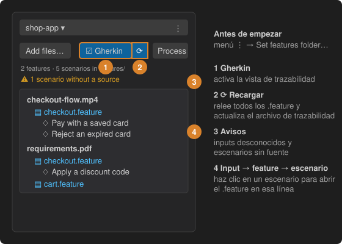

# 5 · Comprueba la trazabilidad de cada feature y escenario



El agente enlaza cada input con los escenarios generados a partir de él mediante comentarios en los archivos `.feature`:

```gherkin
# Inputs: SoA.md, QABAGE.md

Feature: Checkout

  # Source: SoA.md | Created: 2026-09-30
  Scenario: Pay with a saved card
```

En la barra lateral:

1. Fija una vez la **carpeta de features**: menú **⋮** del proyecto → *Set features folder…* (se escanean las subcarpetas).
2. Pulsa **Gherkin** (junto a Process) para ver, bajo cada tarjeta de input, las features que lo citan y sus escenarios. Haz clic en un escenario para abrir el `.feature` en esa línea.
3. Pulsa **⟳** para releer todos los archivos `.feature`. Con la vista activa, las ediciones se recargan solas.
4. Abre la línea de **aviso** para ver los *inputs desconocidos* (un nombre que no es un archivo de input) y los *escenarios sin fuente*, y corrígelos.

Cada recarga escribe además `.spec2test-traceability.json` en la carpeta de features (inputs → features → escenarios), que puedes subir al repositorio. Dentro de un archivo `.feature`, los nombres de input son enlaces a su tarjeta y, al pasar el ratón, indican si está procesado.
