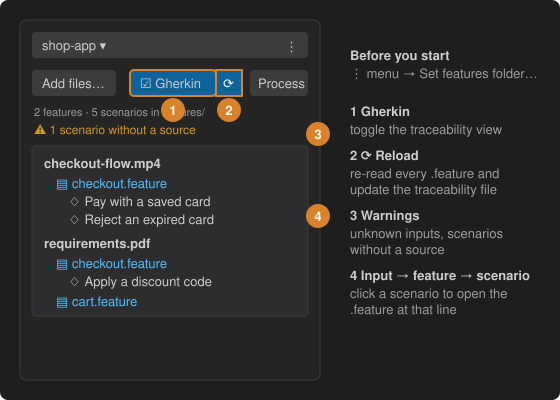

# 5 · Check the traceability of every feature and scenario



The agent links every input to the scenarios generated from it with comments in the `.feature` files:

```gherkin
# Inputs: SoA.md, QABAGE.md

Feature: Checkout

  # Source: SoA.md | Created: 2026-09-30
  Scenario: Pay with a saved card
```

In the sidebar:

1. Set the **features folder** once: project **⋮** menu → *Set features folder…* (subfolders are scanned).
2. Press **Gherkin** (next to Process) to show, under each input card, the features that cite it and their scenarios. Click a scenario to open the `.feature` at that line.
3. Press **⟳** to re-read every `.feature` file. While the view is on, edits reload it automatically.
4. Open the **warning** line to see *unknown inputs* (a name that is not an input file) and *scenarios without a source*, and fix them.

Each reload also writes `.spec2test-traceability.json` in the features folder (inputs → features → scenarios), which you can commit. Inside a `.feature` file, input names are links to the input's card and hovering shows whether it is processed.
