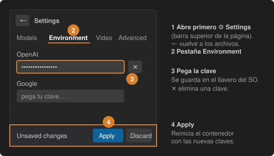

# 2 · Añade tu clave de API

1. En la barra lateral pulsa **⚙ Settings** (arriba a la derecha).
2. Abre la pestaña **Environment**.
3. Pega la clave del proveedor que uses: Google, OpenAI, Anthropic, DeepSeek, OpenRouter o Qwen. La **✕** junto a una clave la elimina.
4. Pulsa **Apply** en la barra *Unsaved changes*. El contenedor se reinicia con las nuevas claves.

Las claves se guardan en el llavero del sistema operativo y se pasan al contenedor como variables de entorno; nunca se escriben en tu proyecto.

Opcional: la pestaña **Models** elige el modelo de texto y el de visión, solo para este proyecto o para todos. Usa un modelo del proveedor cuya clave has añadido.
