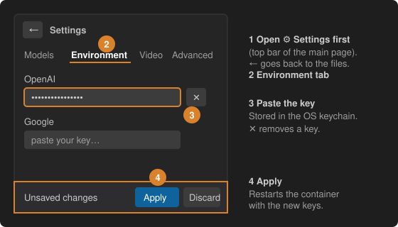

# 2 · Add your API key

1. In the sidebar press **⚙ Settings** (top right).
2. Open the **Environment** tab.
3. Paste the key of the provider you use: Google, OpenAI, Anthropic, DeepSeek, OpenRouter or Qwen. The **✕** next to a key removes it.
4. Press **Apply** in the *Unsaved changes* bar. The container restarts with the new keys.

Keys are kept in the OS keychain and handed to the container as environment variables; they are never written into your project.

Optional: the **Models** tab chooses the text and vision model, for this project only or for all projects. Use a model of the provider whose key you added.
