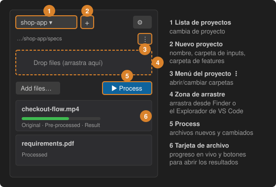

# 3 · Crea un proyecto y procesa tus inputs

Un proyecto es una carpeta de **inputs** (tus especificaciones, grabaciones, PDF, Markdown) más su propia carpeta de **caché** y de **preprocesados**.

1. **Nuevo proyecto** (**+**, o *New project…* en la lista de proyectos): escribe un nombre como `Shop app`, elige la carpeta que ya contiene tus especificaciones (o deja que Spec2Test guarde los archivos) y, por último, la carpeta donde estarán tus archivos `.feature` (puedes fijarla más tarde).
2. **Añadir inputs**: arrastra archivos `.mp4`, `.pdf`, `.md` o `.txt` a la zona **Drop files** situada sobre la página, desde el Finder/Explorador o desde el Explorador de VS Code. O pulsa **Add files…**. Los archivos se copian; tus originales no se tocan.
3. **Procesar**: pulsa **Process**. Cada tarjeta muestra el progreso en vivo y sus botones abren el **Original**, el archivo **Pre-processed** y el **Result**.

El menú **⋮** del proyecto abre o cambia las carpetas de inputs, caché, preprocesados y features.
