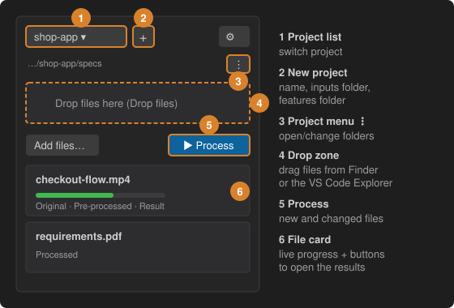

# 3 · Create a project and process your inputs

A project is a folder of **inputs** (your specs, recordings, PDFs, Markdown) plus its own **cache** and **pre-processed** folders.

1. **New project** (**+**, or *New project…* in the project list): type a name such as `Shop app`, then choose the folder that already contains your specs, or let Spec2Test keep the files, and finally the folder where your `.feature` files will live (you can set it later).
2. **Add inputs** – drag `.mp4`, `.pdf`, `.md` or `.txt` files onto the **Drop files** area above the page, from Finder/Explorer or from the VS Code Explorer. Or press **Add files…**. Files are copied; your originals are not touched.
3. **Process** – press **Process**. Each file card shows live progress, and its buttons open the **Original**, the **Pre-processed** file and the **Result**.

The **⋮** menu of the project opens or changes the inputs, cache, pre-processed and features folders.
